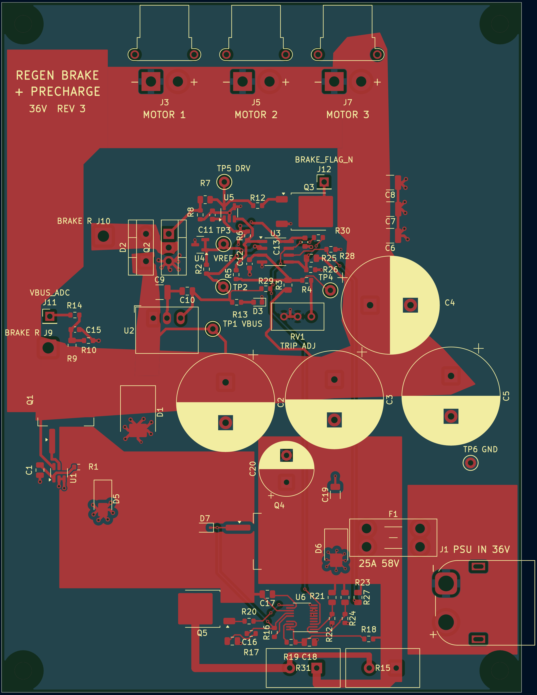
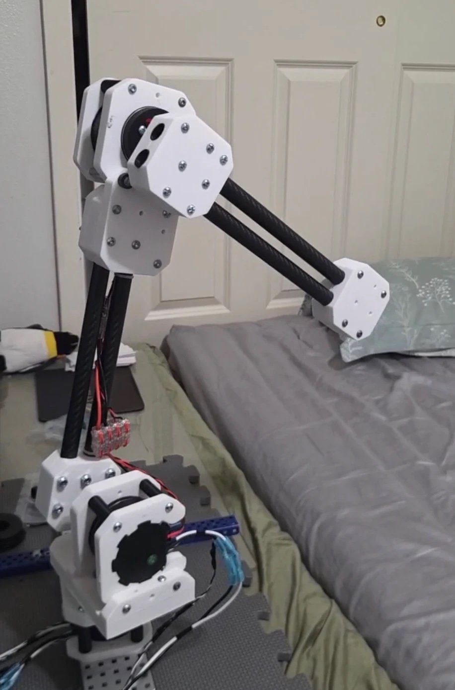
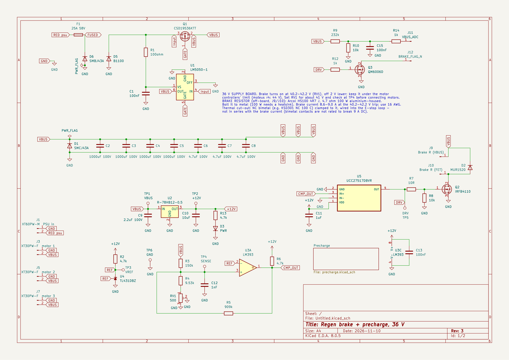
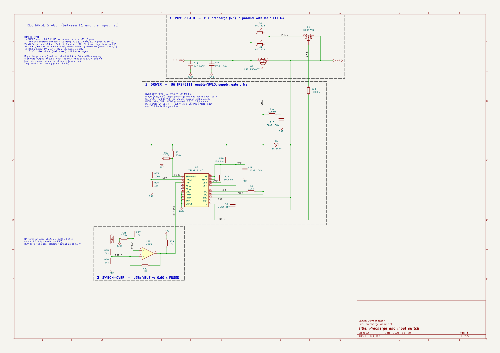

# VLA arm power board

A 36 V regen brake and precharge board for a low-cost robot arm built to train vision-language-action (VLA) models. This repo has the KiCad project, the fabrication and assembly files, the arm's CAD, and the story of how the board came to be.



| | |
| --- | --- |
| **Supply** | 36 V, 27 A bench supply, XT60 input |
| **Loads** | three Unitree IM6014 actuators on XT30 outputs, 15 A each |
| **Board** | rev 3, 2 layers, 2 oz copper, 96.5 × 128 mm, 1.6 mm FR-4 |
| **Status** | ERC and DRC clean (including schematic parity). Ready to fabricate, not yet built. |

## The story

### The arm

The goal is a robot arm cheap enough that students and small labs can collect their own demonstrations and train VLA policies on them. Its first task is scooping ingredients into bowls, the kind of repetitive job fast-casual kitchens do all day.

The arm runs Unitree IM6014 actuators at 36 V over RS-485. LeRobot handles teleoperation and demo collection, and pi0.5 is the first policy. The current build has three joints with 3D-printed housings and carbon-fibre tube links. The joints move under control, the arm is simulated in Gazebo, and inverse kinematics is working. Simulink and LTspice models have been run for the controls and power electronics.



### What went wrong on the bench

Two problems pushed the project toward building its own power electronics.

1. **The USB to RS-485 adapter melted during testing.** A cheap, non-isolated adapter is the only thing between the computer and a motor bus that shares ground with a 27 A supply.
2. **A bench supply can source current but cannot sink it.** When the actuators brake hard they become generators and push energy back onto the 36 V bus. With nowhere to go, the bus voltage climbs, and the motor controllers' absolute limit is 44 V (moteus r4). On top of that, plugging a supply into 4000 µF of bulk capacitance sparks the connector every time.

This board fixes the second problem. An isolated RS-485 hub (next steps below) fixes the first.

### How the board works

```
PSU 36 V ─ XT60 ─ fuse ─ ideal diode ─┬─ main FET ──────────┬─ bus: 4000 µF ─ 3 × XT30 to motors
                                      └─ precharge FET+PTC ─┘          │
                                                                 brake chopper ─ 4.7 Ω 100 W resistor
```

- **Precharge.** At power-up a TI TPS48111-Q1 turns on a small FET that charges the bus through two 60 Ω PTCs in parallel (about 1.2 A at most). When the bus passes 60% of the supply, comparator U3B switches in the main CSD19536KTT FET, slew-limited to about 3 A into the capacitors. No spark.
- **Reverse blocking.** An LM5050-1 ideal-diode controller with a second CSD19536KTT stops regen current from flowing back into the supply.
- **Brake chopper.** A TL431 reference and LM393 comparator with hysteresis watch the bus. At 40.2–42.2 V (set by trimmer RV1) a UCC27517 drives an IRFB4110 that dumps energy into an off-board Arcol HS100 4.7 Ω 100 W resistor. It turns off about 2 V lower, so it cannot latch on at 36 V. An MUR1520 freewheels the resistor's inductance.
- **Protection and extras.** 25 A / 58 V MINI blade fuse, SMBJ43A on the input and SMCJ43A on the bus, a 12 V rail from an R-78HB12, a bus-voltage ADC output and a brake-active flag.




### What changed along the way

- **48 V to 36 V.** An early review offered a 48 V brake window (50.9–57.9 V) and it was picked up without checking against the real supply. That would never have fired before the controllers hit their 44 V limit. The window was moved to 40.2–42.2 V and the TVS diodes were changed to 43 V parts to match.
- **The fuse.** The first design used a 20 A fuse, which looked marginal against the motors' current spikes. With a 27 A supply, F1 became a 25 A part. It is a 58 V-rated MINI fuse, because common 32 V automotive blade fuses are under-rated for this bus.
- **Manufacturability pass (rev 3).** The design rules were raised from KiCad's defaults to JLCPCB's 2 oz limits, which caught XT30/XT60 support pads with 0.2 mm copper rings (now 0.3 mm). Thermal spokes on the connector ground pins were widened, the VBUS pour was widened and fed from a second side, copper was cleared under the mounting screws, and the silkscreen was labelled for assembly.
- **Precharge switch-over at 60%.** This is deliberate. The motors can draw about half an amp while the bus charges without stalling the PTCs. The trade-off is that the bus has to reach 60% before the main FET closes, so the motors should stay disabled until it is fully up.

### Still open

- The arm's real peak current has not been measured yet.
- XT30/XT60 polarity should be checked against the + marks on the physical housings before ordering.
- The TPS48111-Q1 orderable suffix should be confirmed with TI.
- Passives in the BOM are specified by value and rating, not by a particular manufacturer.

## Next steps

- **Isolated RS-485 hub.** USB-C into an FTDI FT4232H, then four isolated RS-485 ports with integrated isolated power (5 kV, rated 25 Mbps, enough for the IM6014's 6 Mbps mode). One port per joint, with TVS protection and switchable termination.
- **Load cell amplifier.** ADS1232 24-bit bridge ADC on an RP2040, weighing each scoop so the policy can be checked against a target portion.
- **CNC aluminium mounts.** The 19 printed joint plates, tube clamps and output hubs remade in 6061-T6. They're shown in aluminium below.


## Files

| Path | Contents |
| --- | --- |
| `hardware/` | KiCad 8 project (open `Untitled.kicad_pro`), with the project symbol and footprint library |
| `fab/regen-board-gerbers.zip` | Gerbers and drill files, ready to upload |
| `fab/regen-board-BOM.xlsx`, `.csv` | Bill of materials for full assembly (55 lines, 82 placements) |
| `fab/regen-board-CPL.csv` | Pick-and-place positions, all parts on the top side |
| `cad/arm-assembly.step` | Arm assembly from Onshape |
| `docs/images/` | Schematics, layout, renders and photos |

**Ordering notes:** 2 layers, 1.6 mm, 2 oz outer copper, HASL lead-free. The fuse insert (Littelfuse 0997025.WXN) and the off-board brake resistor are not placed by the assembler. J9 and J10 are solder pads for the resistor leads. The IRFB4110 brake FET needs a heatsink.

More about the project: [angeloreyes-afk.github.io/portfolio](https://angeloreyes-afk.github.io/portfolio/)

## License

The hardware design files are licensed under the [CERN Open Hardware Licence Version 2 – Strongly Reciprocal](LICENSE) (CERN-OHL-S-2.0). If you make or share a modified version, you must publish your modified design files under the same licence.

Source location: <https://github.com/ANGELOREYES-afk/vla-arm-power-board>
